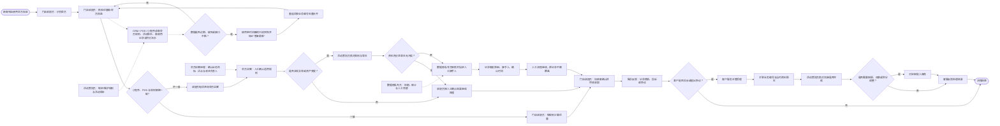

# 拾光连锁｜会员权益与门店服务

## 现状流程图

> 本图描述当前人工流程，不包含拟建设的 AI 方案。流程依据已导出的业务挖掘报告、现场调研报告和 36 条访谈事实整理；其中标记“待核实”的内容需要用真实日志、工单或现场观察补证。

## 泳道角色与系统

| 环节 | 主要角色 | 使用系统/资料 | 当前问题 |
|---|---|---|---|
| 会员识别 | 门店收银员 | POS、会员中心 | 高峰期只能使用现有终端 |
| 权益核验 | 门店收银员、会员运营 | POS、小程序、会员规则 | 同一优惠券解释不一致，需要电话确认 |
| 规则维护 | 活动策划员、会员运营经理 | 活动版本、规则资料 | 版本冲突时不能自行合并或选择较宽松条款 |
| 数据读取 | CRM 工程师 | CRM、POS、小程序 | 旧券未迁移、等级更新延迟、接口可能中断 |
| 异常处理 | 活动策划员、数据隐私专员 | 人工修复队列、审计记录 | 必须记录触发原因、接手人和确认时间 |
| 售后反馈 | 客户服务主管 | 客服工单、业务编号 | 运营、客服、店长关注的指标不同，交接责任不清 |

## 关键异常与人工兜底

1. 退货时积分已经兑换新券，系统没有明确追回规则：暂停自动建议，由活动策划员核对。
2. 资料缺少依据、两个版本冲突或关键系统不可用：转人工，并记录触发原因、接手人和确认时间。
3. 手机号合并会员后旧券未迁移、会员等级更新延迟：进入人工修复队列，不进入自动推荐样本。
4. 涉及退款、积分更改、对外承诺或会员资产变更：必须由对应审批人确认，系统不直接执行。

## 待补证据

- 各节点实际等待时间和处理时间；
- 电话咨询运营次数及近 30 天咨询日志；
- 优惠券规则版本、更新时间和 POS/小程序同步记录；
- 客服投诉、退款、积分调整工单；
- 旧券未迁移、等级延迟和接口中断的历史样本。

